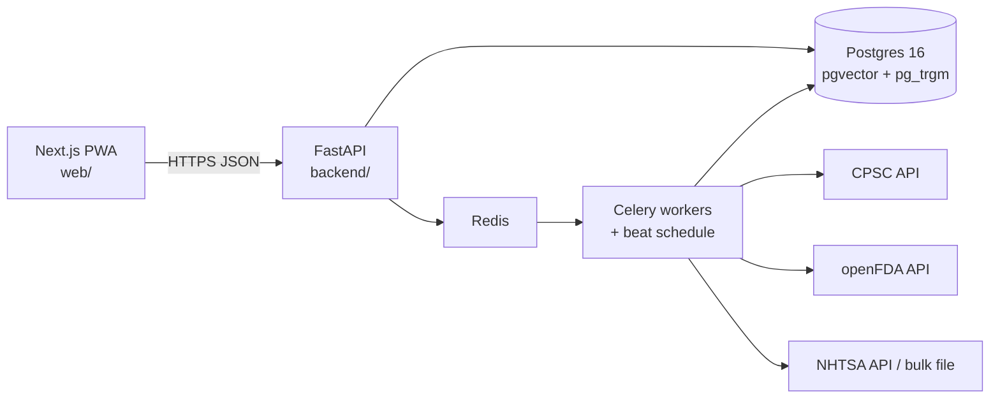

# Recall Radar

[](https://github.com/vivekisreddy/recall-radar/actions/workflows/ci.yml)

**Snap a photo of anything you own. Find out if it's been recalled. Get alerted if it ever is.**

US agencies issue thousands of safety recalls a year: car seats, space heaters, cribs, food, medication, vehicles. The data is public, but it sits on government sites nobody checks, written in prose and keyed on model and lot numbers nobody remembers. Only about [6% of consumers](https://consumerfed.org/news/cfa-news-updates/cfanews-update-september-19-2018/) act on a typical product recall. The gap isn't information. It's delivery.

Recall Radar reads the model, lot and UPC off a product label with OCR and an LLM, matches them against every federal recall, and keeps re-checking your saved items every day.

> **Status:** structuring phase. The skeleton below runs end to end with real recall data; photo scanning, matching and alerts come next ([roadmap](#roadmap)).

## Architecture



| Layer | Tech |
|---|---|
| Frontend | Next.js 16 (App Router, Cache Components), TypeScript, Tailwind CSS 4, shadcn/ui conventions |
| API | FastAPI, Pydantic v2, SQLAlchemy 2, Alembic |
| Data | Postgres 16 + pgvector (embeddings) + pg_trgm (fuzzy model-number match) |
| Jobs | Celery + Redis, daily ingestion via Celery beat |
| Tooling | uv, ruff, pytest against real Postgres, Docker Compose, GitHub Actions |

## Quick start

Requires Docker.

```bash
cp .env.example .env
make up      # db, redis, api, worker, beat, web
make seed    # load 60 real sample recalls (CPSC, FDA, NHTSA)
```

Open http://localhost:3000 for the app and http://localhost:8000/docs for the interactive API docs.

### Developing locally

Run Postgres and Redis in Docker, and the code on your machine with hot reload. Needs [uv](https://docs.astral.sh/uv/) and Node 22.

```bash
make services install migrate seed-local
make api     # terminal 1: http://localhost:8000
make web     # terminal 2: http://localhost:3000
make test    # backend tests against a real Postgres
make lint    # ruff + eslint + tsc
```

`make help` lists every command.

## Project layout

```
backend/                 Python: API, workers, data pipeline (one package, shared models)
  src/recall_radar/
    api/                 FastAPI app, routes, response schemas
    models/              SQLAlchemy models (recalls, products, vehicles, users, items, matches...)
    sources/             One module per agency: fetch + map raw payload -> NormalizedRecall
    ingest/              Idempotent upserts, ingestion runs, sample loader
    workers/             Celery app, schedule and tasks
    core/                Identifier normalisers (model numbers, UPCs)
  alembic/               Database migrations
  tests/                 pytest, using real payloads as fixtures
web/                     Next.js PWA
  src/app/               Pages: home, recalls, recall detail, scan, inventory
  src/lib/api.ts         Typed, server-only client for the backend
research/api-exploration Notebooks + 60 saved payloads from exploring the three agency APIs
docs/decisions.md        Architecture decisions and why
```

## Data sources

| Agency | Covers | Endpoint |
|---|---|---|
| [CPSC](https://www.cpsc.gov/Recalls/CPSC-Recalls-Application-Program-Interface-API-Information) | Consumer products: baby gear, toys, appliances, furniture | `saferproducts.gov/RestWebServices/Recall` |
| [openFDA](https://open.fda.gov/apis/food/enforcement/) | Food, drugs, medical devices | `api.fda.gov/{food,drug,device}/enforcement.json` |
| [NHTSA](https://www.nhtsa.gov/nhtsa-datasets-and-apis) | Vehicles, tires, child car seats | `api.nhtsa.gov/recalls/*` + bulk files |

The [API exploration](research/api-exploration/README.md) found that identifiers mostly live in free text: CPSC's `Model` field was empty in all 93 recalls checked. That finding shapes the whole pipeline. See [docs/decisions.md](docs/decisions.md).

## Roadmap

| Phase | Dates | Focus | Status |
|---|---|---|---|
| Planning | Oct 12 – 18 | Scope, API exploration, stack decisions | ✅ |
| Structuring | Oct 19 – Nov 1 | Repo, schema, API + web skeletons, CI, ingestion | 🚧 skeleton done |
| Implementation | Nov 2 – Dec 13 | LLM extraction, search, inventory, photo scan, hybrid matching, alerts | |
| Testing | Dec 14 – 27 | Golden dataset, eval harness, hardening, beta | |
| Deploying | Dec 28 – Jan 3 | Production deploy, monitoring, write-up | |

## License

[MIT](LICENSE)
